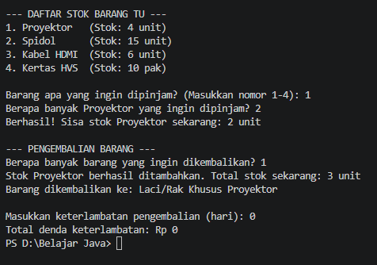

# INVENTARIS TU
Project Ujian Tengah Semester (UTS) mata pelajaran Pemrograman Dasar /
Koding & Kecerdasan Artifisial kelas X PPLG. Aplikasi ini dibuat dalam
dua versi bahasa pemrograman, yaitu **C** dan **Python**.
## Identitas Siswa
* **Nama Lengkap:** FAIZ ANANTA KHOIRI
* **Kelas:** X PPLG
* **No. Absen:** 14
## Deskripsi Aplikasi
Ini program Sistem Inventaris Barang TU buatan kita pakai bahasa Python.

Aplikasi ini dibikin buat ngebantu petugas TU (Tata Usaha) di sekolah biar nggak pusing nyatet peminjaman barang dan ngitung stok manual.

Fitur-fiturnya simpel tapi keren:
Cek Stok Barang: Langsung kelihatan sisa proyektor, spidol, kabel HDMI, sama kertas HVS yang ada di ruang TU.
Pinjam Barang: Kita tinggal pilih barangnya, terus programnya bakal otomatis ngurangin stok. Kalau minjamnya maruk (melebihi stok), bakal dikasih peringatan error.
Balikin Barang & Cek Rak: Pas balikin barang, stoknya bakal nambah lagi dan ada petunjuk barangnya harus disimpan di laci/rak sebelah mana.
Ngitung Denda Otomatis: Kalau balikinnya telat, tinggal masukin berapa hari keterlambatannya, nanti program langsung ngitung total dendanya (Rp 5.000 per hari).
## Daftar File
* `INVENTARISTU.c` : Kode program utama menggunakan bahasa C.
* `INVENTARISTU.py` : Kode program utama menggunakan bahasa Python.
* `outputProgram.png` : Screenshot hasil menjalankan program aplikasi.
## Screenshot Output Program

